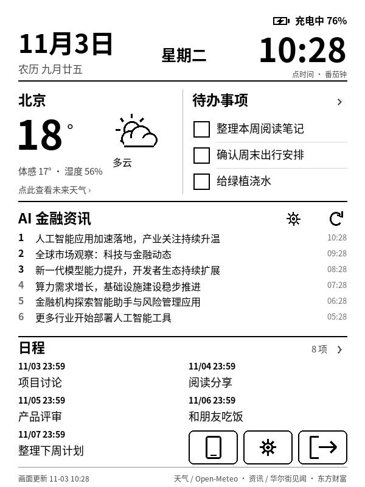
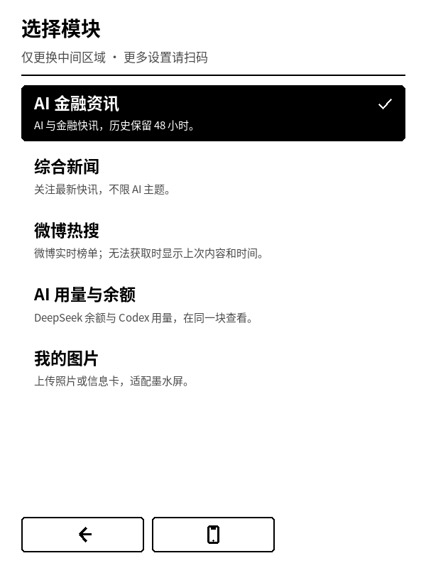

# Kindle Desk v2 · 老 Kindle 模块化桌面看板

把闲置的老 Kindle，变成可以每天使用的墨水屏桌面看板。

天气、日程、待办、农历节气、资讯和番茄钟，直接运行在 Kindle 上。安装完成后，电脑可以关机。


> 宣传图为设备效果示意，屏幕使用虚构示例数据。核心功能已在 **Kindle Basic 7 / KT2（2014），固件 5.12.2.2，600×800** 上运行验证。公开包更换了开源字体并增加首次安装工具，通过电脑侧自检；其他机型尚未验证。

**[下载 v2.0.0](https://github.com/fangheihei-137/kindle-desk/releases/tag/v2.0.0)** · [更新与待机实测](CHANGELOG.md)

## 能做什么

| 功能 | 使用方式 |
| --- | --- |
| 天气与七天预报 | 首页查看温度；点击天气查看未来预报。按网络出口估算城市，也可手动设置。 |
| 日程与日历 | 首页显示五条即将到来的日程；点击日期或日程进入列表、月历。 |
| 待办事项 | 首页显示三条；点方框完成，后续待办自动补位，完成记录仍可查看。 |
| 本机输入 | 看板内直接填写，支持离线拼音、英文、数字；无需切换浏览器。 |
| 手机管理 | 扫码编辑日程/待办、分类设置、上传图片，查看 Wi-Fi 名称。 |
| 自选模块 | 金融资讯、新闻、微博热搜、Codex 额度与 DeepSeek 余额、图片。 |
| 待机桌面 | 电源键休眠和唤醒；日程大日历或全屏等比例裁切图片；唤醒后更新内容。 |
| 番茄钟 | 点时间进入，默认 45 分钟，可设 5–180 分钟；圆环随时间顺时针消失。 |
| 农历与节气 | 日期下方显示农历，星期上方显示当日节日或节气，断网可用。 |
| AI 金融资讯 | 按小时获取，点标题查看近 48 小时缓存，最多 300 条。 |
| 墨水屏刷新 | 启动全刷，随后每 10 次实际画面变化全刷一次，减少残影。 |
| 无线更新 | 打开手机连接页后，电脑可在同一局域网更新程序，保留日程和待办。 |

天气和新资讯需要互联网；日程、待办、计时与农历在本地运行。手机管理需要局域网互通。看板显示与系统待机分开：短按电源键进入待机，运行中的番茄钟保持前台。详见 [待机实测与限制](CHANGELOG.md)。Codex 额度需电脑助手同步，电脑关闭时保留上次值；DeepSeek 显示余额，不是历史 Token 用量。

## 开始之前

这是一套**已越狱 Kindle 上的看板应用**，不是通用越狱工具，也不是任意 Kindle 都能直接安装的商店应用。

目前支持目标是 KT2 的 600×800 竖屏、`eips` 显示和原生触摸接口。安装前需要准备兼容的越狱/启动器以及带 Pillow 的 Kindle Python 3.9 运行环境。

**先看 [安装指南](docs/INSTALL.md)**，确认型号和环境，再复制程序。完整操作见 [使用说明](docs/USAGE.md)，遇到问题见 [常见问题](docs/FAQ.md)。

## 首次安装

电脑安装 Python 3.9 或更高版本，下载仓库并解压。按安装指南准备好 Kindle 的 Python 环境，退出 Kindle 上的其他全屏应用后接入 USB。

**[下载完整项目 ZIP](https://github.com/fangheihei-137/kindle-desk/archive/refs/heads/main.zip)** · [安装指南](docs/INSTALL.md)

```sh
python -m pip install -r requirements.txt
python install.py --check
python install.py F:/
```

`F:/` 只是示例，请换成你的 Kindle 磁盘根目录。macOS / Linux 传入实际挂载目录即可。安装工具只接受含 `documents` 和 Kindle Python 运行环境的目录，遇到已有看板会停止，不会把旧日程替换成空数据。

完成后安全弹出，连接 Wi-Fi，在书库打开 `IndependentDashboard`；若你的启动环境不支持书库脚本入口，从 KUAL 菜单打开 **Kindle Desk**。初次启动日程、待办为空，点手机图标扫码或用本机加号添加。

## 画面预览

以下均为示例数据。


| 首页 | 可调番茄钟 | 日历 |
| --- | --- | --- |
|  |  |  |

| 自选模块 | 待机大日历 |
| --- | --- |
|  |  |

## 数据和项目结构

```text
kindle-standalone/   Kindle 应用、字体、离线拼音和二维码组件
extensions/         KUAL 启动入口
install.py          首次 USB 安装（已有安装会拒绝覆盖）
docs/               安装指南、使用说明、示例画面
scripts/            示例画面与公开包构建工具
tests/              数据保存、触摸、刷新、更新恢复等回归检查
```

每台设备首次安装时生成随机连接凭据。私有数据保存在设备的 `kindle-standalone/data/`；电脑无线更新的凭据保存在本地 `wireless-device.json`。两者都被 Git 忽略，也不会打进公开发布包。不要公开自己设备的连接二维码。

没有账号系统或云端日程服务。程序联网获取天气、按 IP 估算城市及读取资讯；第三方数据服务的可用性会影响这些内容。

## 开发与贡献

```sh
python -m pip install -r requirements.txt
python -m unittest discover -s tests -v
python scripts/render_demo.py
python scripts/build_release.py
```

Python 源码兼容 3.9。桌面端可执行 `python kindle-standalone/app.py --preview` 启动本地预览服务，生成的图像位于 `kindle-standalone/data/preview.png`；此模式不验证 Kindle 硬件接口。

欢迎反馈其他机型的适配情况。提交问题时写明型号、固件、启动方式和现象，日志中请去掉连接凭据及个人日程。

## 许可与致谢

本项目原创代码使用 [MIT License](LICENSE)。第三方字体、词库和库继续使用各自许可，见 [第三方组件说明](THIRD_PARTY_NOTICES.md)。

感谢 KindleModding、NiLuJe、Rime、Adobe 思源字体、lunar-python、Open-Meteo，以及相关开源社区。Kindle 是 Amazon 的商标，本项目为社区项目，与 Amazon 无关联。
